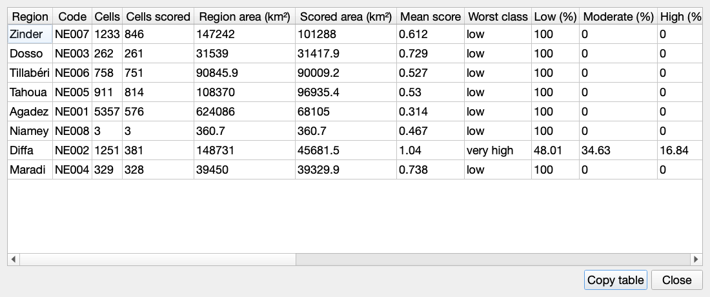

# Using the Agroclimate Risk Panel

*Last reviewed: 2026-10-13.* A walkthrough for QGIS users. What the layers mean is in [reading the risk maps](reading-the-maps.md).

## Where it is

After installing the plugin zip (`Plugins > Manage and Install Plugins > Install from ZIP`), there are four ways to open the panel. It opens as a dock with three tabs: **Run**, **Results**, **Settings**.

1. **The message when QGIS loads the plugin** (once per version) has an **Open the risk panel** button.
2. **The Processing Toolbox**: in the group *FAO Niger Agroclimate*, the first entry is **Agroclimate Risk panel (open this to build the risk map)**. Double-click it and press Run.
3. **The menu**: `Plugins > FAO Niger Agroclimate > Open Agroclimate Risk Panel`.
4. **The toolbar icon.** If you cannot see it, tick `View > Toolbars > Plugins Toolbar`.

The other entries in the Processing Toolbox group (*Fetch ACMAD Boundary Layer* and *Score a zonal layer (vector, advanced)*) are older, advanced tools. They do not build the map and do not download ACMAD hazard data. Use the panel.

If part of the plugin fails to load, QGIS now shows a red message at the top naming the part that failed, and the details go to the Log Messages panel (tab *FAO Niger Agroclimate*).

If you do not see the toolbar icon or the menu entry, check `Plugins > Manage and Install Plugins > Installed` that the plugin is enabled and shows version 0.3.2 or later, then reinstall the zip and restart QGIS.

## What it looks like

The panel is a docked window with three tabs, and each tab scrolls, so nothing is cut off in a short panel. This is the **Run** tab, with the latest published period selected by default:

The **Period** list shows only what ACMAD has published, latest first:

After a run, the **Results** tab shows the class chart and table, and the region summary:

**Larger table** opens every figure of the region summary in a window of its own, to sort, scroll and copy:

And the styled risk class layer on the map (here with OCHA admin level 1 outlines drawn on top):

The screenshots were taken in a headless QGIS 3.28 with live ACMAD data (the 2026-09-11 CDI), the real exposure rasters and the OCHA regions. On macOS, QGIS may draw text with the spaces after commas and full stops squeezed together; that is a Qt rendering quirk with the system font and not part of the plugin.

The older dialog titled "Score a zonal layer (vector, advanced)" is a different, vector-only tool. If you see zone, field and score settings and a "Log" tab, you are in that dialog and not in the panel.

## Run tab: what to choose

| Setting | Choose |
| --- | --- |
| What to map | **Current conditions** for what is happening now (the drought indicator, CDI). **Seasonal outlook** for what the season is expected to bring |
| Period | Pick the period to map from the list. It shows only what ACMAD has **published**, latest first, and the latest ("Latest available") is selected by default. For the seasonal outlook it lists the published seasons instead. **Refresh** asks ACMAD again |
| Other date | The last list entry. It reveals a date box for a date you type. Use it if you are offline; if that date is not published yet, the panel uses the latest earlier period and tells you |
| Exposure folder | A folder holding `cultivated_exposure.tif` and `rangeland_exposure.tif`. **The first time there is nothing in it**: press **Run and add to map** and the panel offers **Prepare exposure, then run**. With **Use ACMAD's prepared exposure** ticked (the default) it downloads four small files (about 66 KB) that ACMAD has already prepared, in a few seconds, checks them, and carries on with the run by itself. Untick the box to build the files yourself from ESA WorldCover land cover instead: about 430 MB and 5 minutes, once. You can also press the button under the box yourself, or point the folder at one that already has the rasters. *Run as a test anyway* uses constant placeholder exposure and is not a real result |
| Use ACMAD's prepared exposure | Leave ticked. ACMAD's files use the same provisional cut-offs as the land cover build, so the maps are the same. Untick it if you want to build exposure from land cover yourself, for example with different cut-offs, or if ACMAD's server cannot be reached |
| Map only cropland and rangeland | Leave ticked. Blank cells are not scored and are not "low risk" |
| Output folder | Where the rasters and `run_metadata.json` are written |
| Advanced | Normally leave alone. It limits how far back the panel may fall back |

Press **Run and add to map**. A progress bar and a log show what is happening, and **Cancel** stops the run.

When you open the panel it asks ACMAD which periods are published, in the background. If ACMAD cannot be reached, the list shows only "Other date" and says so, so being offline never blocks a run.

## What you get

- A group `Agropastoral risk - <period>` at the top of the Layers panel with the **risk class** (visible), the **risk score** and the **hazard** (hidden, tick them to see). The map zooms to Niger.
- The **Results** tab opens: a chart and table of how much of the scored area is in each class, the mean score, and a note if the period is older than you asked for.
- For a summary by region, press **Summarise by region** in the Results tab. With **Use ACMAD's admin level 1 regions** ticked (the default) it fetches Niger's 8 regions from ACMAD (about 180 KB, a few seconds) and needs nothing else; a table appears and a `Risk by region` layer is added to the map. The table scrolls sideways; **Larger table (copy to a spreadsheet)** opens every figure in a window of its own, where you can sort the columns and press **Copy table** to paste it into a spreadsheet. To summarise by your own regions instead, untick the box, pick a polygon layer that is loaded in QGIS (departments, intervention zones, anything), choose its name field and press the same button.
- **Open results folder** shows the files, including the CSV and GeoJSON of the region summary.

## Which boundary is used where

| Step | Boundary |
| --- | --- |
| Building the risk map | Niger's country outline from ACMAD's GeoServer (admin level 0). Recorded in `run_metadata.json` under `boundary` |
| Region summary | By default ACMAD's copy of the official OCHA admin level 1 regions (credit: OCHA Common Operational Dataset, CC BY-IGO). Or any polygon layer you choose |

## Optional: plain-language description

In **Settings**, enter a service address, API key and model for any OpenAI-style language model service, press **Test connection**, then **Save**. On the Results tab, **Describe with the language model** asks you to confirm and then writes a short draft description of the map. It is off until you set it up, it only sends summary figures, and every description is marked as a draft for expert review. Setup, exactly what is sent, reasoning models (and the extra setting they may need), and the error messages are in [language model](language-model.md).

## More help

- Installing, updating and where files go: [installation](installation.md)
- Something not working: [troubleshooting](troubleshooting.md)
- What the layers, classes and blank areas mean: [reading the maps](reading-the-maps.md)
