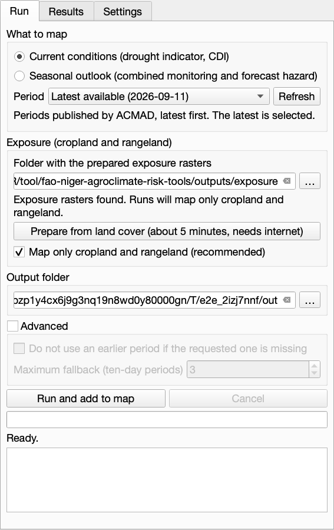
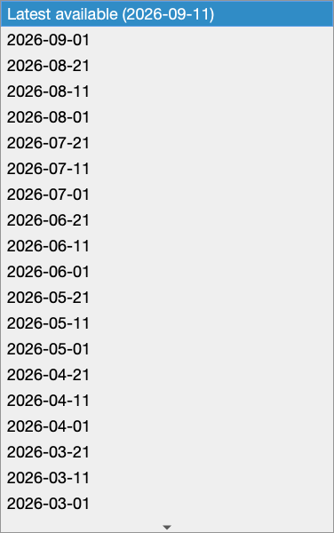
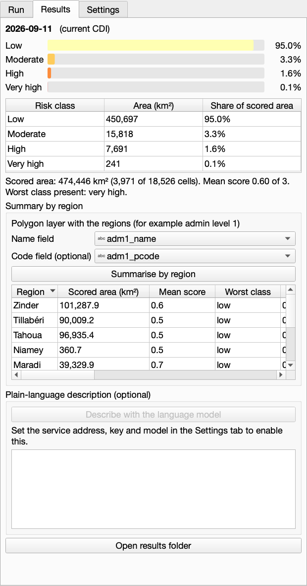
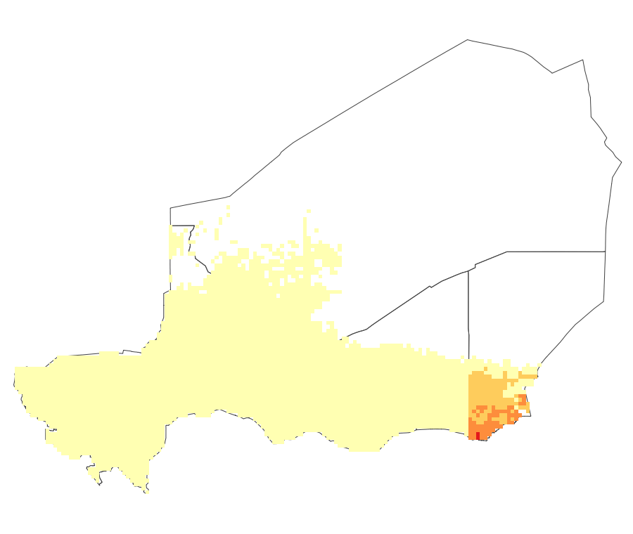

# Using the Agroclimate Risk Panel

*Last reviewed: 2026-10-13.* A walkthrough for QGIS users. What the layers mean is in [reading the risk maps](reading-the-maps.md).

## Where it is

After installing the plugin zip (`Plugins > Manage and Install Plugins > Install from ZIP`), open the panel from the toolbar icon or from `Plugins > FAO Niger Agroclimate > Open Agroclimate Risk Panel`. It opens as a dock with three tabs: **Run**, **Results**, **Settings**.

The Processing Toolbox also lists FAO Niger Agroclimate tools. Those are older, advanced tools that score a vector layer. They do not build the map and do not download ACMAD data. Use the panel.

If you do not see the toolbar icon or the menu entry, check `Plugins > Manage and Install Plugins > Installed` that the plugin is enabled and shows version 0.3.0 or later, then reinstall the zip and restart QGIS.

## What it looks like

The panel is a docked window with three tabs. This is the **Run** tab, with the latest published period selected by default:

The **Period** list shows only what ACMAD has published, latest first:

After a run, the **Results** tab shows the class chart and table, and the region summary:

And the styled risk class layer on the map (here with OCHA admin level 1 outlines drawn on top):

The screenshots were taken in a headless QGIS 3.28 with live ACMAD data (the 2026-09-11 CDI), the real exposure rasters and the OCHA regions. On macOS, QGIS may draw text with the spaces after commas and full stops squeezed together; that is a Qt rendering quirk with the system font and not part of the plugin.

The older dialog titled "Score a zonal layer (vector, advanced)" is a different, vector-only tool. If you see zone, field and score settings and a "Log" tab, you are in that dialog and not in the panel.

## Run tab: what to choose

| Setting | Choose |
| --- | --- |
| What to map | **Current conditions** for what is happening now (the drought indicator, CDI). **Seasonal outlook** for what the season is expected to bring |
| Period | Pick the period to map from the list. It shows only what ACMAD has **published**, latest first, and the latest ("Latest available") is selected by default. For the seasonal outlook it lists the published seasons instead. **Refresh** asks ACMAD again |
| Other date | The last list entry. It reveals a date box for a date you type. Use it if you are offline; if that date is not published yet, the panel uses the latest earlier period and tells you |
| Exposure folder | A folder holding `cultivated_exposure.tif` and `rangeland_exposure.tif`. The first time, press **Prepare from land cover** (about 5 minutes, needs internet) |
| Map only cropland and rangeland | Leave ticked. Blank cells are not scored and are not "low risk" |
| Output folder | Where the rasters and `run_metadata.json` are written |
| Advanced | Normally leave alone. It limits how far back the panel may fall back |

Press **Run and add to map**. A progress bar and a log show what is happening, and **Cancel** stops the run.

When you open the panel it asks ACMAD which periods are published, in the background. If ACMAD cannot be reached, the list shows only "Other date" and says so, so being offline never blocks a run.

## What you get

- A group `Agropastoral risk - <period>` at the top of the Layers panel with the **risk class** (visible), the **risk score** and the **hazard** (hidden, tick them to see). The map zooms to Niger.
- The **Results** tab opens: a chart and table of how much of the scored area is in each class, the mean score, and a note if the period is older than you asked for.
- For a summary by region, add a polygon layer of regions to QGIS (for example OCHA admin level 1), choose it in the Results tab, pick the name field and press **Summarise by region**. A table appears and a `Risk by region` layer is added.
- **Open results folder** shows the files, including the CSV and GeoJSON of the region summary.

## Which boundary is used where

| Step | Boundary |
| --- | --- |
| Building the risk map | Niger's country outline from ACMAD's GeoServer (admin level 0). Recorded in `run_metadata.json` under `boundary` |
| Region summary | Whatever polygon layer you choose; the checked-in tests use the official OCHA admin level 1 |

## Optional: plain-language description

In **Settings**, enter a service address, API key and model for any OpenAI-style language model service. The Results tab then offers **Describe with the language model**. It asks before sending, sends only summary figures, and marks every description as a draft for expert review. The maps and statistics work without it.
